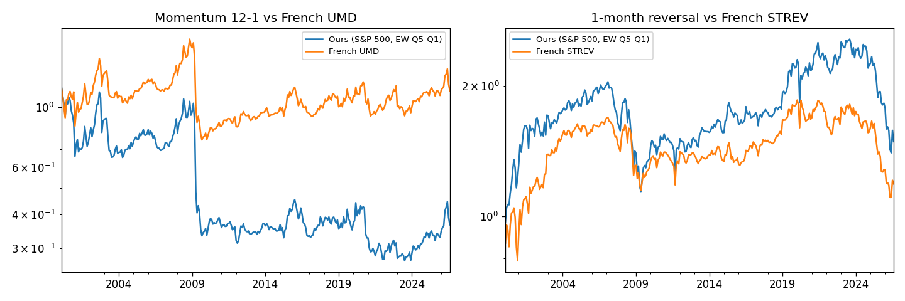

# Factor validation against Ken French

Generated by `scripts/validate_factors.py`. Ours: S&P 500 members at formation, equal-weighted quintiles, long top minus short bottom, monthly rebalance, no costs. French: all US stocks, value-weighted 2x3 sorts. Free price data covers about half of members before 2005 and 90%+ after 2021 (see data_coverage.md), so the 2010+ window is the more trustworthy one.

## full sample: 2000-01 to 2026-07

**Market check:** equal-weighted S&P 500 members vs French market return, correlation 0.928 over 319 months.

| Signal | French factor | Correlation | Beta | Our L/S ann. return | Our Sharpe | Our t | French ann. return | French Sharpe | Mean rank IC | IC t |
|---|---|---|---|---|---|---|---|---|---|---|
| Momentum 12-1 | UMD | 0.93 | 1.12 | -3.7% | -0.06 | -0.30 | +0.5% | 0.12 | 0.001 | 0.08 |
| 1-month reversal | STREV | 0.84 | 0.92 | +1.5% | 0.17 | 0.90 | +0.7% | 0.11 | 0.015 | 1.64 |

Quintile mean monthly returns (1 = lowest signal):

- Momentum 12-1: Q1: +1.11%, Q2: +1.16%, Q3: +1.03%, Q4: +0.94%, Q5: +1.00%
- 1-month reversal: Q1: +0.95%, Q2: +0.99%, Q3: +1.01%, Q4: +1.15%, Q5: +1.16%

## 2010 on, better coverage: 2010-01 to 2026-07

**Market check:** equal-weighted S&P 500 members vs French market return, correlation 0.956 over 199 months.

| Signal | French factor | Correlation | Beta | Our L/S ann. return | Our Sharpe | Our t | French ann. return | French Sharpe | Mean rank IC | IC t |
|---|---|---|---|---|---|---|---|---|---|---|
| Momentum 12-1 | UMD | 0.90 | 1.12 | +0.5% | 0.11 | 0.46 | +2.5% | 0.26 | 0.004 | 0.29 |
| 1-month reversal | STREV | 0.88 | 1.11 | +0.1% | 0.08 | 0.32 | -0.7% | -0.01 | 0.007 | 0.58 |

Quintile mean monthly returns (1 = lowest signal):

- Momentum 12-1: Q1: +1.13%, Q2: +1.23%, Q3: +1.22%, Q4: +1.14%, Q5: +1.28%
- 1-month reversal: Q1: +1.21%, Q2: +1.14%, Q3: +1.12%, Q4: +1.26%, Q5: +1.30%

## Fundamental signals (SEC XBRL), 2011 on: 2011-01 to 2026-07

**Market check:** equal-weighted S&P 500 members vs French market return, correlation 0.951 over 187 months.

| Signal | French factor | Correlation | Beta | Our L/S ann. return | Our Sharpe | Our t | French ann. return | French Sharpe | Mean rank IC | IC t |
|---|---|---|---|---|---|---|---|---|---|---|
| Book-to-market (value) | HML | 0.81 | 1.01 | -3.1% | -0.15 | -0.58 | -1.1% | -0.04 | -0.008 | -0.59 |
| Earnings yield | HML | 0.61 | 0.58 | -1.1% | -0.05 | -0.19 | -1.1% | -0.04 | 0.009 | 0.85 |
| Operating profitability | RMW | 0.46 | 0.44 | +1.8% | 0.27 | 1.07 | +1.9% | 0.27 | 0.013 | 1.71 |
| Gross profitability | RMW | 0.23 | 0.26 | -0.1% | 0.04 | 0.15 | +1.9% | 0.27 | 0.016 | 1.73 |
| Asset growth (investment) | CMA | 0.65 | 0.70 | +0.8% | 0.14 | 0.55 | -0.6% | -0.04 | 0.004 | 0.48 |
| Size (log market cap) | SMB | 0.53 | 0.67 | -0.1% | 0.05 | 0.19 | -2.0% | -0.18 | -0.001 | -0.09 |

Quintile mean monthly returns (1 = lowest signal):

- Book-to-market (value): Q1: +1.35%, Q2: +1.07%, Q3: +1.00%, Q4: +1.04%, Q5: +1.17%
- Earnings yield: Q1: +1.20%, Q2: +0.99%, Q3: +1.15%, Q4: +1.14%, Q5: +1.15%
- Operating profitability: Q1: +1.10%, Q2: +1.08%, Q3: +1.08%, Q4: +1.11%, Q5: +1.27%
- Gross profitability: Q1: +1.05%, Q2: +1.17%, Q3: +1.13%, Q4: +1.34%, Q5: +1.08%
- Asset growth (investment): Q1: +1.10%, Q2: +1.05%, Q3: +1.16%, Q4: +1.09%, Q5: +1.20%
- Size (log market cap): Q1: +1.15%, Q2: +1.17%, Q3: +1.15%, Q4: +1.01%, Q5: +1.20%

