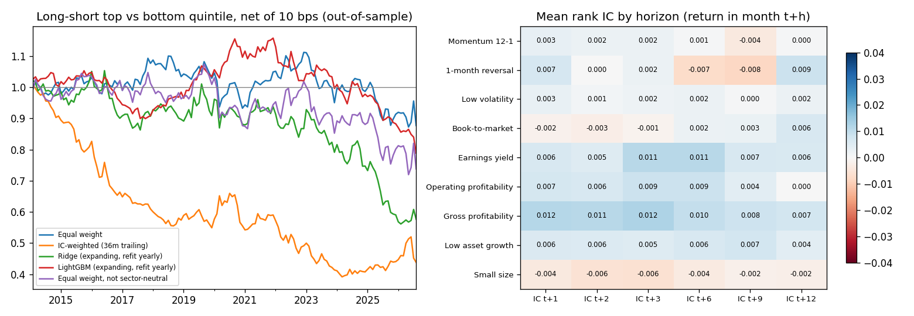

# Research results

Generated by `scripts/run_research.py`. Universe: point-in-time S&P 500 members. Signals are winsorized (1/99%), z-scored and sector-neutralized (Fama-French 12 industries from SEC SIC codes) each month. Portfolios: equal-weighted long top quintile, short bottom quintile, monthly rebalance, dollar neutral. Costs: 10 bps per unit traded unless stated. t-stats are Newey-West (6 lags).

**Caveats.** Free data (yfinance + SEC XBRL) misses many stocks that were later delisted or acquired, so results lean toward survivors (see data_coverage.md, fundamentals_coverage.md). Variants tested in this report: 14 (9 single signals, 5 combinations); none were dropped. Model hyperparameters were fixed in advance, not tuned on this data.

## Single signals, 2011-01 on

| signal | mean_ic | ic_nw_t | gross_ann | gross_t | net_ann | net_sharpe | turnover |
|---|---|---|---|---|---|---|---|
| Momentum 12-1 | 0.003 | 0.29 | -0.3% | 0.17 | -1.4% | -0.05 | 47% |
| 1-month reversal | 0.007 | 0.84 | +0.6% | 0.49 | -3.1% | -0.23 | 156% |
| Low volatility | 0.003 | 0.26 | -3.4% | -0.80 | -4.1% | -0.23 | 27% |
| Book-to-market | -0.002 | -0.14 | -0.1% | 0.16 | -0.5% | 0.01 | 15% |
| Earnings yield | 0.006 | 0.76 | -0.7% | -0.17 | -1.2% | -0.10 | 21% |
| Operating profitability | 0.007 | 1.13 | -0.7% | -0.25 | -1.0% | -0.11 | 12% |
| Gross profitability | 0.012 | 1.41 | -0.2% | 0.05 | -0.4% | -0.01 | 9% |
| Low asset growth | 0.006 | 0.93 | +1.7% | 1.11 | +1.3% | 0.24 | 19% |
| Small size | -0.004 | -0.47 | -0.7% | -0.12 | -1.0% | -0.05 | 10% |

Turnover = average monthly share of the book replaced.

## IC decay

Mean monthly rank IC between the signal at t and the return in month t+h.

| signal | IC t+1 | IC t+2 | IC t+3 | IC t+6 | IC t+9 | IC t+12 |
|---|---|---|---|---|---|---|
| Momentum 12-1 | 0.003 | 0.002 | 0.002 | 0.001 | -0.004 | 0.000 |
| 1-month reversal | 0.007 | 0.000 | 0.002 | -0.007 | -0.008 | 0.009 |
| Low volatility | 0.003 | 0.001 | 0.002 | 0.002 | 0.000 | 0.002 |
| Book-to-market | -0.002 | -0.003 | -0.001 | 0.002 | 0.003 | 0.006 |
| Earnings yield | 0.006 | 0.005 | 0.011 | 0.011 | 0.007 | 0.006 |
| Operating profitability | 0.007 | 0.006 | 0.009 | 0.009 | 0.004 | 0.000 |
| Gross profitability | 0.012 | 0.011 | 0.012 | 0.010 | 0.008 | 0.007 |
| Low asset growth | 0.006 | 0.006 | 0.005 | 0.006 | 0.007 | 0.004 |
| Small size | -0.004 | -0.006 | -0.006 | -0.004 | -0.002 | -0.002 |

## Fama-MacBeth (all signals together)

Monthly cross-sectional regression of next-month return on all nine cleaned signals; slope = return in basis points per one standard deviation of the signal, holding the others fixed.

| signal | mean_slope_bp | nw_t | months |
|---|---|---|---|
| Momentum 12-1 | +7.2 | 0.90 | 187 |
| 1-month reversal | -1.8 | -0.28 | 187 |
| Low volatility | -4.7 | -0.56 | 187 |
| Book-to-market | +1.9 | 0.24 | 187 |
| Earnings yield | -7.4 | -1.36 | 187 |
| Operating profitability | +7.8 | 2.36 | 187 |
| Gross profitability | -1.5 | -0.34 | 187 |
| Low asset growth | +5.5 | 1.43 | 187 |
| Small size | -4.8 | -1.14 | 187 |

## Combined signals, out-of-sample 2014-01 on

Ridge and LightGBM are refit every January on all earlier data whose outcome was already known, then score the following 12 months. IC weights use only past ICs. Equal weight has no fitted parameters.

| method | mean_ic | ic_nw_t | gross_ann | net_ann | net_sharpe | net_nw_t | max_dd | turnover | months |
|---|---|---|---|---|---|---|---|---|---|
| Equal weight | 0.011 | 1.89 | +0.8% | -1.0% | -0.09 | -0.45 | -21.5% | 76% | 151 |
| IC-weighted (36m trailing) | -0.018 | -1.77 | -4.7% | -6.3% | -0.56 | -2.10 | -61.1% | 71% | 151 |
| Ridge (expanding, refit yearly) | -0.007 | -0.84 | -2.6% | -4.3% | -0.41 | -1.74 | -46.7% | 74% | 151 |
| LightGBM (expanding, refit yearly) | 0.002 | 0.30 | +0.3% | -1.9% | -0.29 | -0.99 | -31.8% | 90% | 151 |
| Equal weight, not sector-neutral | 0.011 | 1.39 | -0.7% | -2.4% | -0.19 | -0.94 | -33.0% | 74% | 151 |

### Net Sharpe by cost assumption

| method | 0 bps | 5 bps | 10 bps | 20 bps |
|---|---|---|---|---|
| Equal weight | 0.14 | 0.02 | -0.10 | -0.33 |
| IC-weighted (36m trailing) | -0.40 | -0.48 | -0.57 | -0.73 |
| Ridge (expanding, refit yearly) | -0.23 | -0.32 | -0.41 | -0.60 |
| LightGBM (expanding, refit yearly) | 0.07 | -0.11 | -0.29 | -0.66 |
| Equal weight, not sector-neutral | -0.02 | -0.11 | -0.20 | -0.38 |

### Attribution: net returns on Fama-French 5 + momentum

| method | alpha_ann | alpha_nw_t | r2 | b_Mkt-RF | b_SMB | b_HML | b_RMW | b_CMA | b_UMD |
|---|---|---|---|---|---|---|---|---|---|
| Equal weight | -2.8% | -2.21 | 0.36 | 0.07 | 0.06 | 0.26 | 0.41 | -0.00 | 0.18 |
| IC-weighted (36m trailing) | -7.4% | -2.87 | 0.16 | 0.09 | -0.17 | 0.01 | -0.25 | -0.08 | 0.21 |
| Ridge (expanding, refit yearly) | -5.6% | -2.70 | 0.07 | 0.08 | 0.10 | 0.04 | 0.27 | -0.03 | 0.13 |
| LightGBM (expanding, refit yearly) | -3.1% | -2.11 | 0.12 | 0.06 | 0.00 | -0.06 | 0.14 | -0.09 | 0.06 |
| Equal weight, not sector-neutral | -3.3% | -1.86 | 0.44 | -0.01 | 0.13 | 0.40 | 0.57 | -0.08 | 0.21 |

## Sector counts (tickers in the index since 2009)

Unknown: 237, Money: 122, BusEq: 112, Other: 86, Manuf: 60, Shops: 54, Hlth: 50, NoDur: 39, Utils: 35, Enrgy: 24, Chems: 21, Durbl: 11, Telcm: 9

