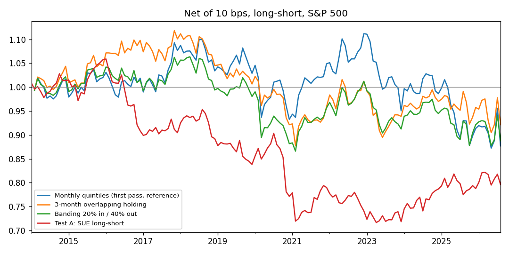

# Pre-registered test results

Generated by `scripts/run_tests.py`. Definitions and criteria: [PREREGISTRATION.md](../PREREGISTRATION.md). Costs 10 bps per unit traded; Newey-West t-stats.

## Test A: earnings surprise (SUE), S&P 500

Formation months 2012-01 to 2026-07; signal available for 88% of member-months on average (a quarter filed in the prior 92 days).

| Measure | Value |
|---|---|
| Mean rank IC (t) | 0.0007 (0.11) |
| Long-short gross / net, per year | -0.71% / -2.19% |
| Net Sharpe (Newey-West t) | -0.32 (-1.15) |
| Long leg / short leg mean monthly return | +1.18% / +1.22% |
| Monthly turnover (share of book) | 63% |
| Alpha vs FF5 + momentum, per year (t) | -3.37% (-2.88) |
| Months | 175 |
| IC at t+1 / t+2 / t+3 / t+6 | 0.0007 / 0.0037 / 0.0003 / -0.0051 |

**Verdict: NO EFFECT (both t < 1).**

Secondary, not used for the verdict: SUE added to the equal-weight composite (2014-01 on).

| Composite | Mean IC | Net per year | Net Sharpe | t |
|---|---|---|---|---|
| Composite, 9 signals | 0.0112 | -1.04% | -0.09 | -0.45 |
| Composite + SUE, 10 signals | 0.0118 | -1.35% | -0.13 | -0.64 |

## Test B: lower-turnover construction of the 9-signal composite, S&P 500

Out-of-sample 2014-01 on. The reference row is the first-pass construction, not a test variant.

| Construction | Gross per year | Net per year | Net Sharpe | Net t | Monthly turnover | Verdict |
|---|---|---|---|---|---|---|
| Monthly quintiles (first pass, reference) | +0.76% | -1.04% | -0.09 | -0.45 | 76% | reference |
| 3-month overlapping holding | +0.07% | -0.65% | -0.06 | -0.31 | 31% | NOT A FINDING |
| Banding 20% in / 40% out | -0.05% | -0.94% | -0.12 | -0.53 | 38% | NOT A FINDING |

