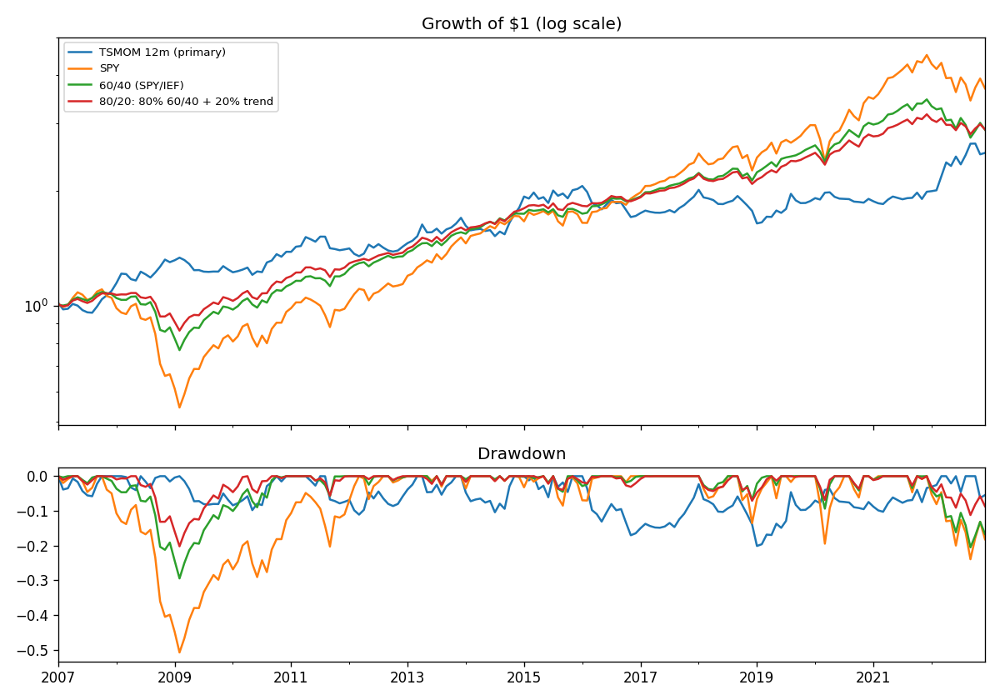

# Trend following results: Development

Generated by `scripts/run_backtest.py`. Design fixed in advance in README.md. Strategy returns are net of 10 bps per unit traded and a 0.5%/yr short-borrow fee; Sharpe uses excess returns over T-bills; t-stats are Newey-West (6 lags). Backtest only, ETF proxies, no live trading.

## Development sample

| Series | Period | CAGR | Vol | Sharpe | t | Max DD | Worst year |
|---|---|---|---|---|---|---|---|
| TSMOM 12m (primary) | 2007-01 to 2022-12 | +5.9% | 10.7% | 0.51 | 2.01 | -20.1% | -14.9% (2016) |
| TSMOM 1/3/12m blend (secondary) | 2007-01 to 2022-12 | +4.7% | 11.1% | 0.40 | 1.68 | -19.2% | -5.3% (2009) |
| SPY | 2007-01 to 2022-12 | +8.5% | 16.0% | 0.54 | 2.06 | -50.8% | -36.8% (2008) |
| 60/40 (SPY/IEF) | 2007-01 to 2022-12 | +6.8% | 9.5% | 0.65 | 2.57 | -29.5% | -18.0% (2008) |
| 80/20: 80% 60/40 + 20% trend | 2007-01 to 2022-12 | +6.9% | 7.6% | 0.80 | 3.31 | -20.2% | -11.3% (2008) |

## Cost sensitivity (primary)

| Cost per unit traded | Sharpe | CAGR |
|---|---|---|
| 5 bps | 0.56 | +6.5% |
| 10 bps | 0.51 | +5.9% |
| 20 bps | 0.42 | +4.8% |

## Positioning (primary)

Average gross exposure 310% of capital (max 400%); average net long +89%; average monthly turnover 86%; average cost drag 1.03%/yr plus borrow 0.55%/yr; assets held: 13 to 20.

## Crisis and stress windows

| Window | Trend 12m | Trend blend | SPY | 60/40 | 80/20 |
|---|---|---|---|---|---|
| 2008 | +18.8% | +26.9% | -36.8% | -18.0% | -11.3% |
| 2020 Q1 | +5.1% | +11.8% | -19.4% | -8.1% | -5.5% |
| 2022 | +26.2% | +22.7% | -18.2% | -16.7% | -8.7% |

## Correlations of monthly returns (primary)

- With SPY: -0.17
- With 60/40: -0.16
- Primary with secondary: 0.76

## Validation against live managed-futures funds

Correlation of monthly total returns over each fund's overlapping history. Fund returns are after their fees; ours are after modelled costs only.

| Fund | Overlap | Months | Correlation | Our Sharpe (same months) | Fund Sharpe |
|---|---|---|---|---|---|
| AQMIX (AQR Managed Futures (fund)) | 2010-02 to 2022-12 | 155 | 0.71 | 0.50 | 0.28 |
| DBMF (iMGP DBi Managed Futures ETF) | 2019-06 to 2022-12 | 43 | 0.83 | 0.78 | 0.95 |
| KMLM (KraneShares Mount Lucas Managed Futures ETF) | 2021-01 to 2022-12 | 24 | 0.71 | 1.00 | 0.88 |

## Return by asset class (primary, before costs, annualized)

| Class | Contribution |
|---|---|
| Bonds | +3.1% |
| Commodities | +1.6% |
| Equities | +1.5% |
| Currencies | +0.8% |
| Real estate | +0.1% |

## Sub-periods

| Period | Series | Months | CAGR | Sharpe | t | Max DD |
|---|---|---|---|---|---|---|
| 2007-2014 | TSMOM 12m (primary) | 2007-01 to 2014-12 | +7.7% | 0.72 | 1.99 | -11.1% |
| 2007-2014 | TSMOM 1/3/12m blend (secondary) | 2007-01 to 2014-12 | +6.7% | 0.61 | 1.71 | -14.0% |
| 2007-2014 | SPY | 2007-01 to 2014-12 | +7.0% | 0.45 | 1.02 | -50.8% |
| 2007-2014 | 60/40 (SPY/IEF) | 2007-01 to 2014-12 | +7.2% | 0.71 | 1.72 | -29.5% |
| 2015-latest | TSMOM 12m (primary) | 2015-01 to 2022-12 | +4.2% | 0.33 | 0.98 | -20.1% |
| 2015-latest | TSMOM 1/3/12m blend (secondary) | 2015-01 to 2022-12 | +2.8% | 0.21 | 0.71 | -19.2% |
| 2015-latest | SPY | 2015-01 to 2022-12 | +10.1% | 0.62 | 2.35 | -23.9% |
| 2015-latest | 60/40 (SPY/IEF) | 2015-01 to 2022-12 | +6.5% | 0.60 | 2.00 | -20.5% |

## Calendar years

| Year | Trend 12m | Trend blend | SPY | 60/40 | 80/20 |
|---|---|---|---|---|---|
| 2007 | +9.6% | +2.0% | +5.1% | +7.4% | +7.9% |
| 2008 | +18.8% | +26.9% | -36.8% | -18.0% | -11.3% |
| 2009 | -4.3% | -5.3% | +26.4% | +12.6% | +9.3% |
| 2010 | +11.2% | +8.0% | +15.1% | +13.5% | +13.2% |
| 2011 | +1.4% | +6.9% | +1.9% | +7.7% | +6.5% |
| 2012 | +1.7% | +3.5% | +16.0% | +11.2% | +9.3% |
| 2013 | +18.8% | +9.8% | +32.3% | +15.6% | +16.3% |
| 2014 | +6.2% | +4.7% | +13.5% | +11.8% | +10.8% |
| 2015 | +11.9% | -3.8% | +1.2% | +1.7% | +3.8% |
| 2016 | -14.9% | -2.2% | +12.0% | +7.7% | +2.9% |
| 2017 | +12.3% | +7.1% | +21.7% | +13.7% | +13.4% |
| 2018 | -8.2% | -3.3% | -4.6% | -2.0% | -3.2% |
| 2019 | +6.1% | -5.1% | +31.2% | +21.8% | +18.8% |
| 2020 | +1.3% | +9.2% | +18.3% | +16.0% | +13.2% |
| 2021 | +4.4% | +0.8% | +28.7% | +15.1% | +12.9% |
| 2022 | +26.2% | +22.7% | -18.2% | -16.7% | -8.7% |

